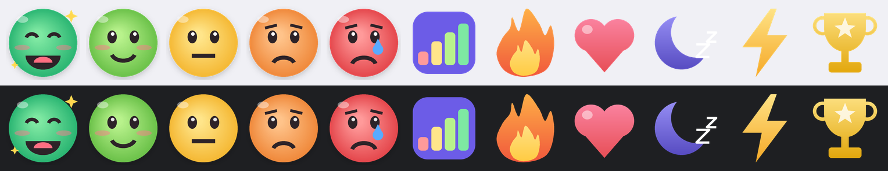
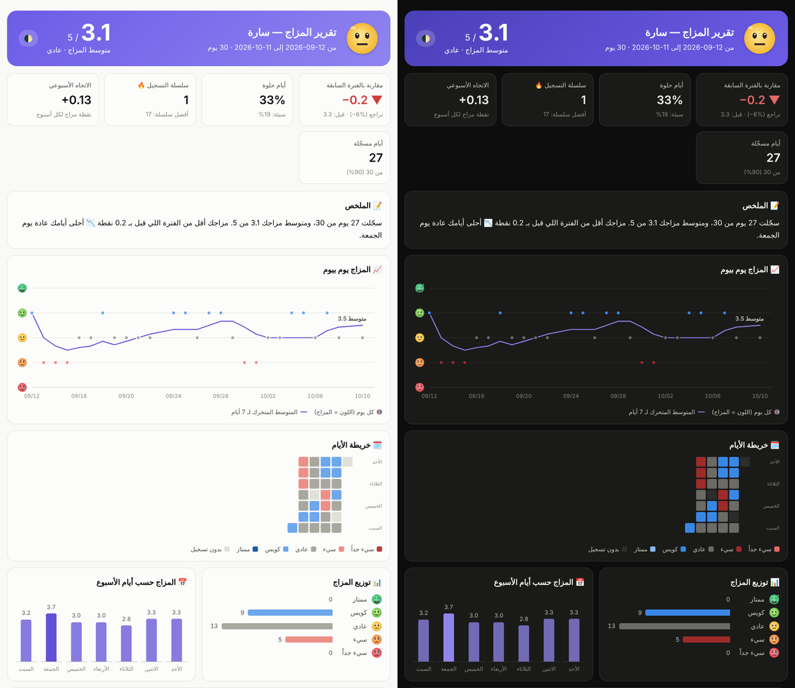

# Mood Bot 🌈

بوت ديسكورد يرسل كل يوم الساعة **2:30** رسالة خاصة لشخص تحدده: **"كيف كان يومك؟"**
يسجّل مزاجه ووش اللي خلّى يومه حلو أو سيء، ويطلع **تقارير احترافية** بالرسوم تبيّن إذا مزاجه يتحسن ووش يأثر عليه.

<p align="center"></p>

- **TypeScript** يشتغل مباشرة على Node.js 22.18+ بدون بناء
- **بدون أي مكتبة وقت التشغيل** (zero dependencies). البوت كله **~340 كيلوبايت** (أقل من 2% من حد الـ 20 ميقا)
- اتصال ديسكورد مكتوب من الصفر: Gateway بـ WebSocket المدمج، وREST بـ fetch، وقاعدة بيانات بـ `node:sqlite`
- **64 اختبار**، منها اختبار تكامل يشغّل البوت الحقيقي ضد سيرفر ديسكورد وهمي

---

## ✨ المميزات

| | |
|---|---|
| 🕑 **سؤال يومي** | يوصل في الخاص بالوقت اللي تحدده، مع 5 وجوه (ممتاز ← سيء جداً) وزر "ذكّرني بعد ساعة" |
| 📝 **تفاصيل اليوم** | نافذة فيها: أبرز شي صار، المشاكل، شي ممتن له، ساعات النوم، الطاقة من 10 |
| 🏷️ **الأنشطة** | بعد التسجيل يختار وش سوّى (شغل، رياضة، أصحاب، ضغط، نوم سيء… 22 نشاط)، والتقارير تحسب وش يرفع مزاجه ووش ينزله |
| 🤖 **ذكاء اصطناعي** (اختياري) | رد ودود بلهجتنا على كل تسجيل، وتحليل احترافي للتقارير، ودردشة حرة في الخاص مع ذاكرة |
| 📊 **تقارير HTML** | متوسط المزاج، نسبة التحسن، رسم يومي مع متوسط متحرك، خريطة الأيام، أيام الأسبوع، أثر الأنشطة، النوم والطاقة، الإنجازات، والسجل الكامل. فيها وضع ليلي وتشتغل على الجوال وبدون إنترنت |
| 📬 **تقارير تلقائية** | أسبوعية (كل جمعة 9 الليل) وشهرية (أول كل شهر) للشخص ولك |
| 🔍 **أنماط** | `/insights`: وش يرفع مزاجك، أحلى وأصعب يوم بالأسبوع، علاقة النوم والطاقة بالمزاج، الاتجاه، التقلب |
| 🏆 **إنجازات وسلسلة** | 16 إنجاز (🔥 3 أيام، ⚡ أسبوع، 🏅 شهر، 🌈 رجعة قوية…) تحفّز على التسجيل اليومي |
| 💛 **شبكة أمان** | لو انكتب كلام مقلق: رسالة دعم بأرقام المساعدة وتنبيه لك. ولو المزاج سيء 3 أيام ورا بعض يوصلك تنبيه |
| ⏰ **تذكير وإجازة** | تذكير تلقائي لو ما رد، ووضع إجازة يوقف السؤال كم يوم |
| ⚙️ **إعدادات لكل شخص** | الوقت والمنطقة الزمنية والتذكير، وتقدر تتابع أكثر من شخص |
| 📦 **بياناتك لك** | تصدير CSV (يفتح بـ Excel) أو JSON، وحذف كامل بضغطة، ونسخ احتياطية يومية تلقائية |
| 😄 **11 إيموجي خاص** | مرسومة للبوت وتنرفع تلقائياً، وتشتغل في الخاص وأي سيرفر |

<p align="center"></p>

---

## 🚀 التشغيل (10 دقايق)

### 1) جهّز Node.js
نزّل **Node.js 22.18 أو أحدث** من [nodejs.org](https://nodejs.org) (نسخة LTS).

### 2) سوّ البوت في ديسكورد
1. ادخل [Discord Developer Portal](https://discord.com/developers/applications) واضغط **New Application**
2. من **Bot** اضغط **Reset Token** وانسخ التوكن (لا تعطيه أحد!)
3. من **Installation**:
   - فعّل **Guild Install**، وفي Scopes حط `bot` و `applications.commands`
   - (اختياري) فعّل **User Install** عشان الأوامر تشتغل في أي مكان
4. افتح رابط التثبيت وضيف البوت لسيرفر **فيه الشخص** (لازم يكونون في سيرفر واحد عشان يقدر يرسل له خاص)

### 3) جيب الـ ID
في ديسكورد: الإعدادات ← Advanced ← فعّل **Developer Mode**، بعدين كليك يمين على الشخص ← **Copy User ID**. سوّ نفس الشي لنفسك.

### 4) الإعدادات
```bash
cd mood
cp .env.example .env
```
افتح `.env` وعبّي:
```env
DISCORD_TOKEN=التوكن
TARGET_USER_ID=ID الشخص
OWNER_ID=ID حقك
CHECKIN_TIME=14:30        # 2:30 الظهر. لو تبيه 2:30 الفجر حط 02:30
```

### 5) شغّل
```bash
npm start
```
ما يحتاج `npm install`: البوت ما يستخدم أي مكتبة.
أول تشغيل يسجّل الأوامر ويرفع الايموجيات تلقائياً.

> 💡 تبي تشوف شكل التقرير قبل كل شي؟ شغّل `npm run demo`، وبيطلع تقرير تجريبي في `data/reports/`.

---

## 💬 الأوامر

| الأمر | وش يسوي |
|---|---|
| `/checkin` | سجّل يومك الحين (المالك يقدر يرسل السؤال للشخص) |
| `/report` | تقرير أسبوع، شهر، 3 شهور أو سنة، مع ملف HTML بالرسوم |
| `/insights` | الأنماط: وش يرفع مزاجك ووش ينزله |
| `/history` | آخر الأيام باختصار |
| `/achievements` | الإنجازات والسلسلة 🔥 |
| `/talk` | دردش مع مود 🤖 (أو كلّم البوت في الخاص مباشرة) |
| `/settings` | `time` · `timezone` · `reminder` · `pause` · `resume` · `show` |
| `/export` | نزّل البيانات CSV أو JSON |
| `/forget` | احذف كل البيانات (يطلب تأكيد) |
| `/admin` | للمالك: نظرة عامة، إرسال السؤال الحين، نسخة احتياطية |
| `/help` | المساعدة |

---

## 🤖 الذكاء الاصطناعي (اختياري)

حط مفتاح من [console.anthropic.com](https://console.anthropic.com) في `ANTHROPIC_API_KEY` وخلاص.
البوت يستخدم Claude (`claude-opus-5-5` افتراضياً، وتغيره من `AI_MODEL`) في:
- **رد على كل تسجيل**: يفهم وش كتب الشخص، ويقترح شي عملي لو يومه سيء، ويلاحظ الأنماط
- **تحليل التقارير**: ملخص، وش يحسّن المزاج، وش يخربه، و3 نصائح مبنية على بياناته هو
- **دردشة حرة في الخاص**: تتذكر آخر السوالف وتعرف مزاجه في آخر أسبوعين

فيه إعادة محاولة تلقائية، وموديل احتياطي (fallback) لو الطلب انرفض، وحد 40 رسالة بالساعة عشان التكلفة.
**بدون مفتاح كل شي يشتغل**: الردود جاهزة، والتحليل محلي من الأرقام والأنشطة.

> 💸 لو تبي تكلفة أقل: `AI_MODEL=claude-haiku-5-5`

---

## 🐳 التشغيل على سيرفر (24/7)

**Docker:**
```bash
docker compose up -d
docker compose logs -f
```
الصورة فيها Node بس (بدون مكتبات)، والبيانات تنحفظ في `./data`، وفيها فحص صحة تلقائي.

**أو pm2:**
```bash
npm i -g pm2
pm2 start "npm start" --name mood-bot
pm2 save && pm2 startup
```

---

## ⚙️ كل الإعدادات

| المتغير | الافتراضي | الوصف |
|---|---|---|
| `DISCORD_TOKEN` | — | توكن البوت (**لازم**) |
| `TARGET_USER_ID` | — | ID الشخص (أو أكثر مفصولين بفاصلة) (**لازم**) |
| `OWNER_ID` | — | ID حقك (تشوف التقارير وتوصلك التنبيهات) |
| `TIMEZONE` | `Asia/Riyadh` | المنطقة الزمنية |
| `CHECKIN_TIME` | `14:30` | وقت السؤال (24 ساعة) |
| `REMINDER_AFTER_HOURS` | `3` | التذكير بعد كم ساعة (0 = بدون) |
| `WEEKLY_REPORT_DAY` | `friday` | يوم التقرير الأسبوعي (`friday` أو `الجمعة`) |
| `WEEKLY_REPORT_TIME` | `21:00` | وقت التقارير |
| `MONTHLY_REPORT` | `true` | تقرير شهري |
| `ALERTS` | `true` | تنبيهات المزاج السيء والكلام المقلق للمالك |
| `LOW_MOOD_ALERT_DAYS` | `3` | كم يوم سيء ورا بعض قبل التنبيه |
| `NOTIFY_OWNER` | `false` | إشعار لك كل ما سجّل يومه |
| `ANTHROPIC_API_KEY` | — | مفتاح Claude (اختياري) |
| `AI_MODEL` | `claude-opus-5-5` | الموديل |
| `AI_CHAT` | `true` | الدردشة في الخاص |
| `DATA_DIR` | `./data` | مكان البيانات |
| `BACKUP_KEEP` | `14` | عدد النسخ الاحتياطية اليومية |
| `LOG_LEVEL` | `info` | `debug` / `info` / `warn` / `error` |
| `STATUS_TEXT` | `كيف كان يومك؟ 🌈` | حالة البوت |

كل شخص يقدر يغيّر وقته ومنطقته الزمنية والتذكير بنفسه من `/settings`.

---

## 🛡️ قوة وثبات

- **ما يفوّت السؤال**: لو البوت كان طافي وقت السؤال، يرسله أول ما يشتغل بنفس اليوم
- **إعادة اتصال ذكية**: يكمل الجلسة بعد أي انقطاع بدون ما تضيع رسائل، ويكشف الاتصال الميت
- **يحترم حدود ديسكورد**: طابور لكل مسار، ويعيد المحاولة مع 429 و 5xx وأخطاء الشبكة
- **ما يطيح**: كل أمر وكل مهمة مجدولة معزولة، والأخطاء ترجع برسالة لطيفة للمستخدم وإعادة محاولة تصاعدية
- **ما يزعج**: لو الخاص مقفل ينبّهك مرة وحدة بس، والتقارير ما تتكرر
- **بياناتك بأمان**: SQLite بوضع WAL، ونسخة احتياطية يومية (`data/backups`)، وكل النصوص في التقارير محمية من الحقن (XSS)
- **إطفاء نظيف** مع `Ctrl+C` و `SIGTERM`

---

## 🧪 التطوير

```bash
npm install        # أدوات التطوير فقط (TypeScript والأنواع)
npm run check      # فحص الأنواع + كل الاختبارات
npm test           # 64 اختبار
npm run demo       # تقرير تجريبي
npm run size       # حجم البوت
npm run dev        # تشغيل مع إعادة تحميل تلقائي
```

```
mood/
├── start.mjs              يتأكد من نسخة Node ويشغّل البوت
├── src/
│   ├── index.ts           نقطة التشغيل
│   ├── app.ts             قلب البوت (الخدمات المشتركة)
│   ├── scheduler.ts       السؤال اليومي، التذكير، التقارير، النسخ الاحتياطية
│   ├── router.ts          توزيع الأوامر والأزرار مع الصلاحيات
│   ├── commands.ts        تعريف الأوامر
│   ├── features/          checkin · reports · companion · settings · alerts · misc
│   ├── discord/           Gateway (WebSocket) · REST · ثوابت ديسكورد
│   ├── ai.ts              Claude (اختياري)
│   ├── report.ts          تقرير HTML والرسوم
│   ├── stats.ts           الإحصائيات والأنماط
│   ├── db.ts              قاعدة البيانات (node:sqlite)
│   ├── achievements.ts · safety.ts · moods.ts · time.ts · config.ts · emojis.ts
├── assets/emojis/         الايموجيات (128px) + emojis-small (للتقارير)
├── test/                  اختبارات الوحدات والتكامل + سيرفر ديسكورد وهمي
└── tools/make_emojis.py   أداة رسم الايموجيات (Pillow، للتطوير فقط)
```

---

> 🔒 **الخصوصية:** البيانات كلها محفوظة عندك في `data/mood.db`، وما تطلع إلا لـ Claude لو فعّلت الذكاء الاصطناعي.
> الشخص يشوف تحت كل سؤال إن تقاريره يطّلع عليها المالك، ويقدر يصدّر بياناته أو يحذفها متى ما بغى.
>
> 💛 البوت مو بديل عن مختص. لو لاحظت إن الشخص تعبان كثير، كلّمه.
